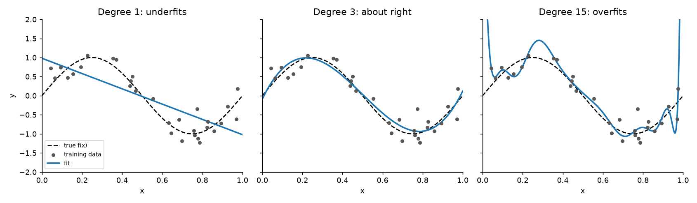
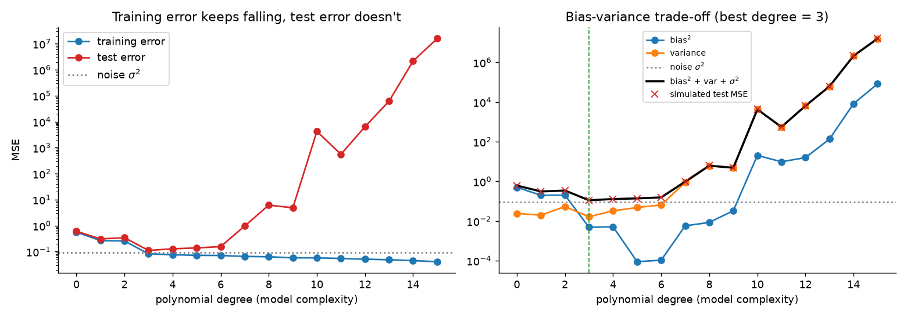
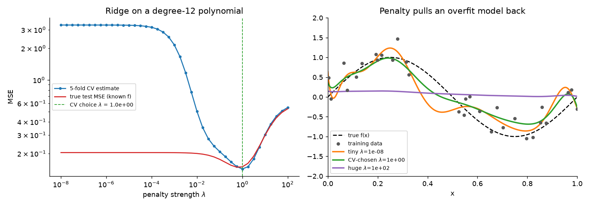
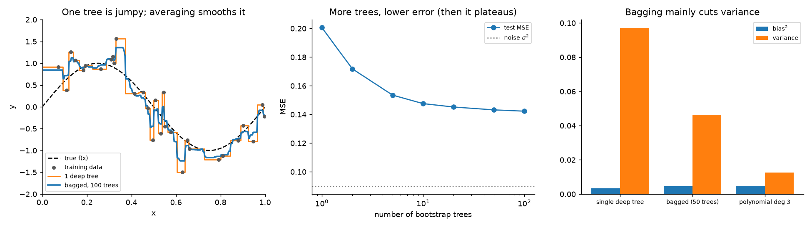
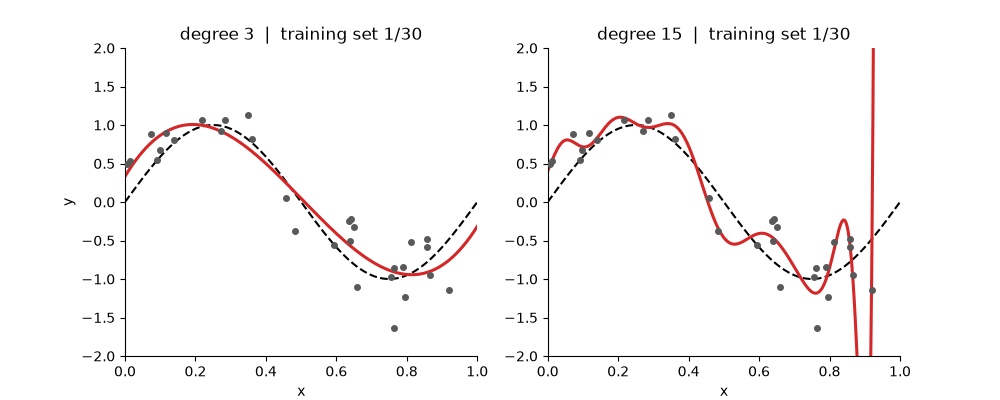

# Bias–Variance Lab

A small Monte Carlo simulation that shows **why models overfit** and what we can do about it. It covers polynomial regression, the bias–variance decomposition, ridge regression with cross-validation, and bagged regression trees. Every model is written from scratch in NumPy.

Real data comes from an unknown process. Here the true function is known:

```math
X \sim \text{Uniform}(0,1), \qquad Y = \sin(2\pi X) + \varepsilon, \qquad \varepsilon \sim \mathcal{N}(0, \sigma^2)
```

Because the truth is known, the simulation can draw hundreds of independent training sets and refit the model on each one. That lets it **measure** each part of the expected test error directly:

```math
\mathbb{E}\big[(Y - \hat f(X))^2\big] = \underbrace{\big(\mathbb{E}[\hat f(X)] - f(X)\big)^2}_{\text{bias}^2} + \underbrace{\mathrm{Var}[\hat f(X)]}_{\text{variance}} + \underbrace{\sigma^2}_{\text{noise}}
```

## Results

### 1. Under- vs overfitting


### 2. The bias–variance trade-off
Training error keeps falling as the degree grows, but test error falls and then rises again (U-shape). The simulated test MSE (crosses) matches bias² + variance + σ², which checks the decomposition numerically.



### 3. Ridge regression and cross-validation
A degree-12 polynomial overfits badly on its own. Adding a ridge penalty λ‖β‖² shrinks it back toward a sensible fit. 5-fold cross-validation picks λ using only the training data, and its curve follows the true test error closely.



### 4. Trees and bagging
A fully grown regression tree memorises its training set, so it has low bias and high variance. Bagging fits trees on bootstrap resamples and averages them. This mostly reduces **variance**, and the error levels off once enough trees are averaged.



### 5. Watching variance happen
Each frame uses a new training set drawn from the same distribution. The faded lines are the fits from earlier frames. The degree-3 fits stay close together, while the degree-15 fits swing wildly.



## Run it

```bash
pip install -r requirements.txt
python run_experiments.py            # writes all figures to ./figures
python run_experiments.py --help     # options: --sims, --n-train, --noise, --seed, --no-gif
pytest                               # sanity tests for the models
```

Things to try:
- `--n-train 200`: more data lowers variance, so higher degrees stop overfitting as much.
- `--noise 0.8`: more noise raises the error floor and makes simpler models win.

## Project structure

```
biasvariance/
  models.py        PolynomialRegression (+ ridge), RegressionTree, BaggedTrees, all NumPy
  simulation.py    data-generating process, Monte Carlo bias–variance, k-fold CV
run_experiments.py runs every experiment and saves the figures
tests/             pytest sanity checks (interpolation, ridge limit, tree memorisation, ...)
```

## Concepts covered

| Topic | Where |
|---|---|
| Random variables, densities, noisy measurements | `simulation.sample` (the generative model) |
| Least squares and polynomial regression | `PolynomialRegression` |
| Overfitting, training vs test error | Figure 1, Figure 2 (left) |
| Bias–variance decomposition | `simulation.bias_variance`, Figure 2 (right) |
| Ridge regularisation and cross-validation | Figure 3 |
| Regression trees, bootstrap, bagging | `RegressionTree`, `BaggedTrees`, Figure 4 |

Built as a side project while studying an introductory data science course.
